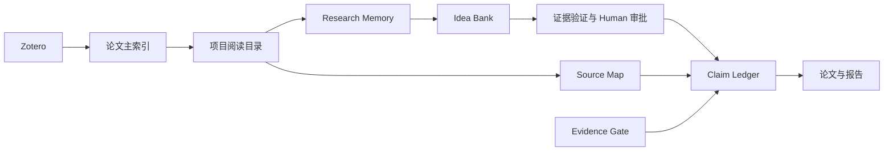

# 本地知识库构建框架

## 1. 系统定位

知识库以本地文件为事实来源，用稳定 ID、元数据和关联记录把文献阅读连接到研究项目。网站是公开内容的展示层；后续即便加入检索和编辑，也应复用原注册表、Research Memory 与写作支持体系。

这里的“知识库”不仅是 PDF 集合，也不是已经建好的向量数据库。目前确认存在的是目录、CSV 注册表、Markdown 节点、工作流和脚本。语义检索、用户系统与在线编辑是待开发能力。

## 2. 六层结构

| 层 | 事实来源 | 职责 | 边界 |
|---|---|---|---|
| 文献资产 | Zotero 条目与 storage | 元数据、原文和附件 | 不直接改 SQLite，不默认复制 PDF |
| 注册与路由 | codex/registry/ | 稳定 paper_id、项目归属、阅读状态、附件映射 | paper_index.csv 是阅读阶段主索引 |
| 阅读材料 | project/<Project>/<Topic>/<Paper>/ | 速览、问题、深读、最终总结 | 原文证据与个人解释分别记录 |
| 研究记忆 | codex/research_memory/ | 论文、概念、想法、项目关系与复盘 | 记忆节点成熟度不等于论文阅读阶段 |
| 项目证据 | project/<Project>/04_writing_support/ | 来源、论断、证据门、提纲和写作队列 | 不建立第二套 claim 系统 |
| 交付展示 | reports/ 与公开网站 | 文献分享、机制讲解、项目汇报 | 公开导出只含获准内容 |

## 3. 目录契约

```text
workspace/
├── codex/
│   ├── registry/
│   │   ├── projects.yml
│   │   ├── paper_index.csv
│   │   ├── reading_status.csv
│   │   └── zotero_attachment_manifest.csv
│   ├── workflows/
│   ├── templates/
│   ├── scripts/
│   └── research_memory/
│       ├── papers/ concepts/ ideas/ projects/
│       ├── figures/ indices/ dashboards/
│       └── review_queue.md / review_log.md
├── project/<Project>/
│   ├── 00_base_papers/
│   ├── 01_related_work/
│   ├── 02_methods/
│   ├── 03_experiments/researchbridge_specs/E###.md
│   ├── 04_writing_support/
│   └── 99_archive/
└── reports/<report-id>/
```

单篇论文目录以 `<year>_<first_author>_<short_title_slug>` 命名，放置 `metadata.json`、`paper.bib`、`source_links.md`、`quicklook.md`、`questions.md`、`deep_reading.md`、`final_report.md` 和 `assets/`。按需添加 `critical_reading.md`。

`reading_status.csv` 用于状态操作与下一步任务记录；不要让它和 `paper_index.csv` 形成两个独立事实源。未来适配器应从主索引生成视图，并报告冲突供人工核对。

## 4. 核心对象

| 对象 | 身份与字段 | 关联 |
|---|---|---|
| Paper | paper_id、title、DOI/arXiv、year、venue、status、projects、folder | Zotero key、阅读材料、概念、项目 |
| Attachment | parent_item_key、attachment_key、role、resolved_path | 对应原文、翻译版或双语版 |
| Concept | 当前理解、机制、confidence、maturity、来源、复盘日期 | 论文、相关概念、想法 |
| Idea | idea ID、问题、假设、状态、验证计划 | 概念、项目 idea_bank、潜在证据 |
| Claim | claim ID、类型、状态、证据、写作位置、限制 | source_map、evidence_gate |
| Review | 对象、上次日期、决策、原因、下次动作 | review_queue 与 review_log |

`paper_id` 复用已有登记值。DOI/arXiv 与规范化标题用于去重；标题模糊匹配只产生候选，不自动合并。跨项目引用同一论文不应重新发明身份。

## 5. 关系与可追溯性



论文节点引用阅读目录；概念卡记录具体来源；idea 保留待验证状态；正文句子能返回 claim，再返回论文、实验产物或配置。未完成工作保留 `TBD` 与阻塞原因。

## 6. 实现边界

公开站不读取本机目录、不访问 Zotero，也不运行实验。本地原始工作区当前非 Git 仓库，来源记录使用 `git_commit: not_available`；YuxPaper 自身的 GitHub 提交与原工作区来源版本是两回事。
